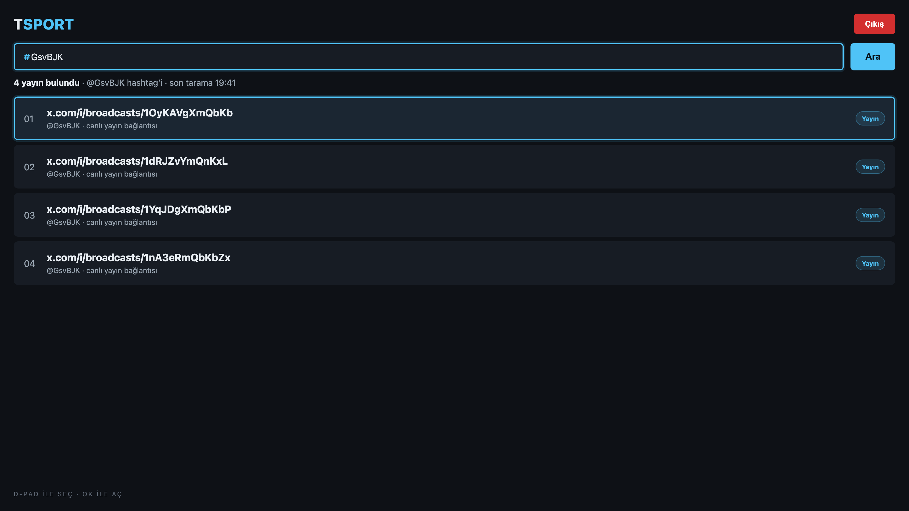

# TSport

> An Android TV and phone app that finds X/Twitter hashtag broadcast links and opens them on the big screen.

[](https://developer.android.com/)
[](https://developer.android.com/training/tv)
[](https://kotlinlang.org/)
[](LICENSE)

<p align="center">
  <a href="https://www.buymeacoffee.com/cmtrkr"></a>
</p>

TSport is a small Kotlin app for following live broadcasts shared under a hashtag on X. Sign in to X inside the app, type a hashtag (for example `GsvBJK`), and TSport searches the live tab for posts containing `"broadcasts"` and links. It extracts and de-duplicates `x.com/i/broadcasts/...` URLs, resolves `t.co` redirects, and presents a D-pad-friendly list. Selecting an item opens the broadcast in a browser or player.

It works on Android TV boxes and phones, has no backend, and stores only the X session cookies needed for the search.

## 📸 Screenshot

<p align="center">
  
  <br>
  <sub>Representative preview built from the app's real TV layout, colors and labels — not a TV capture.</sub>
</p>

## ✨ Features

- 🔐 **In-app X login** — a WebView login flow with session detection.
- 🔎 **Hashtag search** — searches X's live tab for `#tag "broadcasts" filter:links`.
- 🔗 **Broadcast extraction** — keeps only `x.com/i/broadcasts/...` links.
- 🧹 **Deduplication and `t.co` resolution** — concurrent redirect resolution, one row per broadcast.
- 📺 **TV-first UI** — dark theme, focus rings, D-pad navigation and a leanback launcher entry.
- 📱 **Phone support** — the same APK runs on normal Android phones.
- 🚪 **Logout** — clears the local X session.
- 🛡️ **No backend** — searches happen in the app's WebView; there is no server in the middle.

## 🏗️ How it works

1. `LoginActivity` opens X in a WebView and detects a signed-in session.
2. `SearchQueryBuilder` normalizes the hashtag and builds the live-search URL.
3. A hidden WebView loads the results page; the page is parsed for candidate links.
4. `LinkExtractor` normalizes URLs, resolves `t.co` redirects in parallel, keeps valid broadcast IDs and removes duplicates.
5. `MainActivity` renders the list; selecting a row opens the broadcast externally.

```text
Hashtag → X live search (WebView) → candidate URLs → t.co resolution
        → x.com/i/broadcasts/<id> → deduplicated list → external player
```

## 🚀 Build

Requirements: JDK 17, Android SDK 35, Gradle (wrapper included).

```bash
./gradlew assembleDebug
adb install -r app/build/outputs/apk/debug/app-debug.apk
```

Open the project in Android Studio for a graphical build. The package id is `com.tsport.links`; minSdk 24, targetSdk 35.

## 📁 Project structure

```text
app/src/main/java/com/tsport/links/
├── auth/        # X WebView login and session detection
├── search/      # Query building, WebView scraping and view model
├── links/       # URL extraction, t.co resolution, link model
└── ui/          # MainActivity and RecyclerView adapter
```

## ⚠️ Notes

- A signed-in X account is required; X may rate-limit or change its search markup at any time.
- The app depends on X's web UI. If X changes the live-search page, extraction may need an update.
- Use it for lawful, personal access to public broadcasts. It is not affiliated with X Corp.
- Test on your device before relying on it during a live event.

## ❤️ Support

If TSport helps you find the match, you can buy me a coffee:

<p align="center">
  <a href="https://www.buymeacoffee.com/cmtrkr"></a>
</p>

## 📄 License

[MIT](LICENSE) © 2026 Cem Türker.
